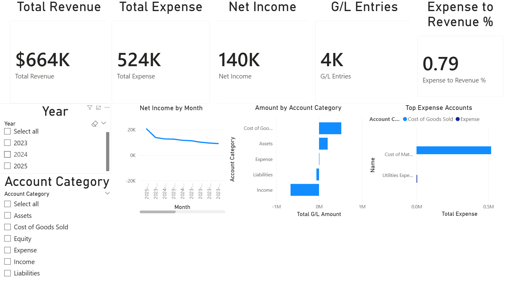
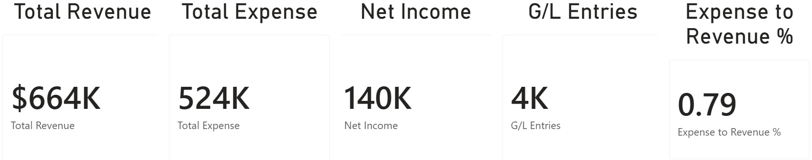
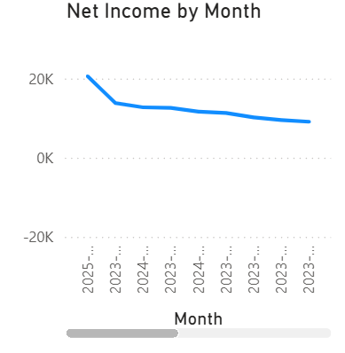
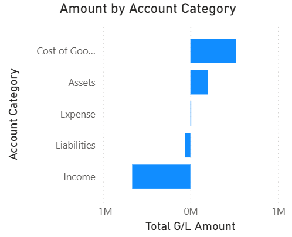
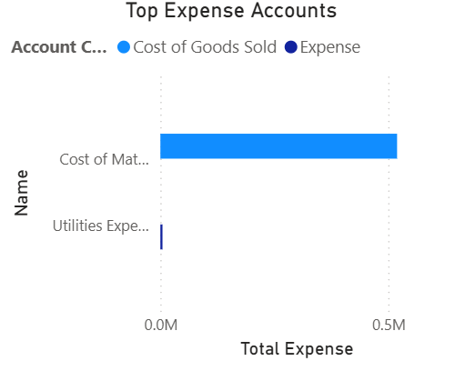
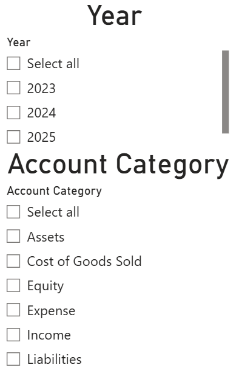

# Business Central Finance Insights Dashboard

## Description

A Power BI report and data model built on general ledger data from the CRONUS demo company in Microsoft Dynamics 365 Business Central.

The dashboard features:

- High-level finance KPIs  
- Net income trend over time  
- Balance by account category (income, COGS, expense, assets, liabilities)  
- Top expense accounts by amount  
- Expense-to-revenue ratio for a selected period  

All data is loaded from Business Central via configuration packages and staged in Excel before being modeled in Power BI Desktop.

## Objective

Provide a finance overview dashboard that shows:

- **How the business is performing overall** (Total Revenue, Total Expense, Net Income)
- **Where spend is concentrated** (Top Expense Accounts)
- **How the chart of accounts rolls up** (Amount by Account Category)
- **How profitability evolves over time** (Net Income by Month)
- **How efficient the cost structure is** (Expense to Revenue %)

## Technologies

- **Power BI Desktop** – data model, DAX measures, and report layout
- **Power Query** – data shaping and loading from Excel staging files
- **Excel** – staging area for configuration package exports
- **Dynamics 365 Business Central (CRONUS demo database)**
  - G/L Account (Table 15)
  - G/L Entry (Table 17)
  - Customer Ledger Entry (Table 21)
  - Vendor Ledger Entry (Table 25)
  - Accounting Period (Table 50)
  - Dimension (Table 348)
  - Dimension Value (Table 349)
  - Bank Account (Table 270)
- **Git + GitHub** – version control

## Data Model

The data model is centered on the **G/L Entry** table with related dimension tables.

- **Fact**
  - `G/L Entry`
- **Dimensions**
  - `G/L Account`
  - `Date` (calculated table)
  - `Accounting Period`
  - `Customer Ledger Entry`
  - `Vendor Ledger Entry`
  - `Bank Account`
  - `Bank Account Ledger Entry`
  - `Dimension`
  - `Dimension Value`

Key relationships (core to the current visuals):

- `G/L Entry[Posting Date]` → `Date[Date]`
- `G/L Entry[G/L Account No.]` → `G/L Account[No.]`
- `Accounting Period[Starting Date]` → `Date[Date]`



## Measures

All core metrics are defined as DAX measures in a dedicated **Measure** table.

```DAX
Total G/L Amount :=
SUM ( 'G/L Entry'[Amount] )

Total Revenue :=
CALCULATE (
    [Total G/L Amount],
    'G/L Account'[Account Category] = "Income"
)

Total Expense :=
CALCULATE (
    [Total G/L Amount],
    'G/L Account'[Account Category] IN { "Cost of Goods Sold", "Expense" }
)

Net Income :=
[Total Revenue] + [Total Expense]

Total Revenue (Abs) :=
ABS ( [Total Revenue] )

Total Expense (Abs) :=
ABS ( [Total Expense] )

Net Income (Abs) :=
[Total Revenue (Abs)] - [Total Expense (Abs)]

G/L Entry Count :=
COUNTROWS ( 'G/L Entry' )

Expense to Revenue % :=
DIVIDE ( [Total Expense (Abs)], [Total Revenue (Abs)] )
```

These measures power all visuals on the Finance Overview page.  

## Report Pages  

### 1. Finance Overview  

High-level KPIs, trend analysis, and expense breakdowns.  

#### KPIs  



Cards across the top of the page highlight:

- Total Revenue (Abs)  
- Total Expense (Abs)  
- Net Income (Abs)  
- G/L Entry Count  
- Expense to Revenue %  

These respond to all slicers and filters on the page.  

#### Net Income by Month  



A line chart using the `Date` table shows **Net Income (Abs)** by Month, giving quick insight into profitability trends over time.  

#### Amount by Account Category  



A bar chart showing:

- `G/L Account[Account Category]` on the vertical axis  
- `Total G/L Amount` on the horizontal axis  

This highlights the distribution of income, cost of goods sold, expense, asset, and liability balances for the selected period.  

#### Top Expense Accounts  



A bar chart showing the top expense accounts by **Total Expense (Abs)**, filtered to:

- `G/L Account[Account Category] ∈ { "Cost of Goods Sold", "Expense" }`  

This quickly surfaces which accounts drive most of the spend.  

#### Slicers  



Two main slicers enable fast filtering:

- **Year** – filters the `Date` table, which propagates to all visuals  
- **Account Category** – filters the chart of accounts and related visuals  

This combination provides options to quickly filter by fiscal year and high-level account group.  

## Interactions & Filtering  

### Filtering  

- Use **Year** and **Account Category** slicers to restrict the time period and focus on specific account groups.  
- KPI cards, the Net Income by Month line chart, and both bar charts respond instantly to slicer changes.  
- A visual-level filter on **Top Expense Accounts** restricts the chart to cost of goods sold and expense categories so it behaves like an expense drill view rather than a full chart-of-accounts listing.  

## Usage Guide  

### Refreshing the Dashboard with a Different Company or Environment  

1. Export the same core tables (**G/L Account** and **G/L Entry**) from another Business Central company using Configuration Packages. Include any additional tables already present in the model if you want to populate those as well.

2. Replace the Excel file(s) in the `Docs/Data` folder, keeping sheet and column names consistent.

3. Open the `.pbix` in Power BI Desktop.

4. Update file paths in Power Query if needed.

5. Click **Refresh** to rebuild the model and visuals with the new data.
